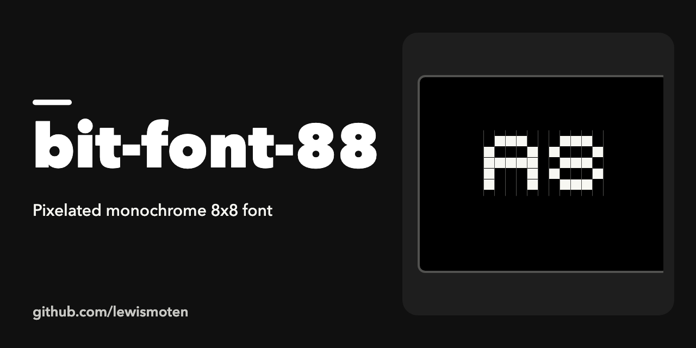

# bit-font-88

A pixelated monochrome 8x8 font.

Try out the 8-bit [Draw](https://lewismoten.github.io/bit-font-88/draw/) page to draw 8x8 characters. The page and its scripts are in [draw/](draw/).

## License

MIT. See [LICENSE.md](LICENSE.md).
